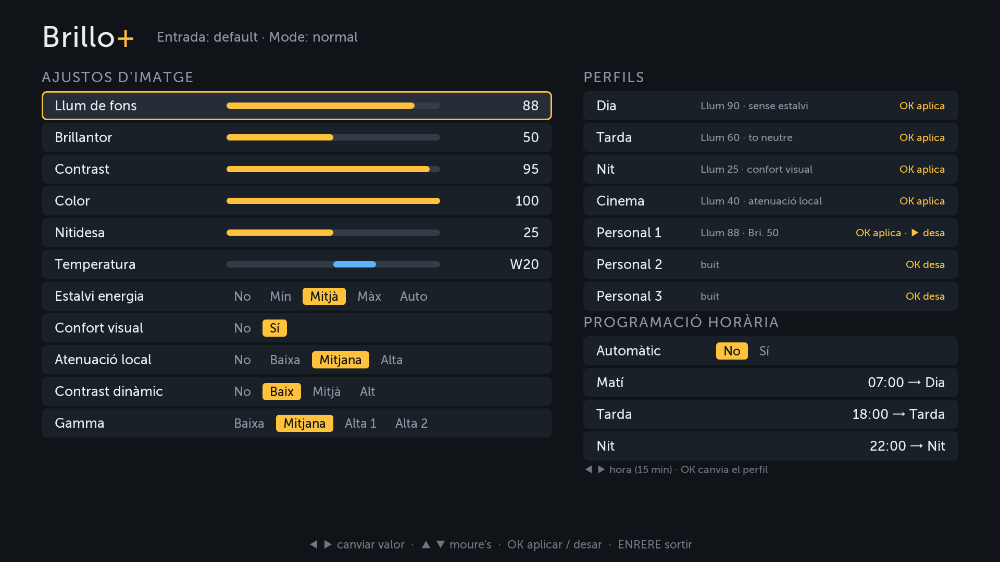
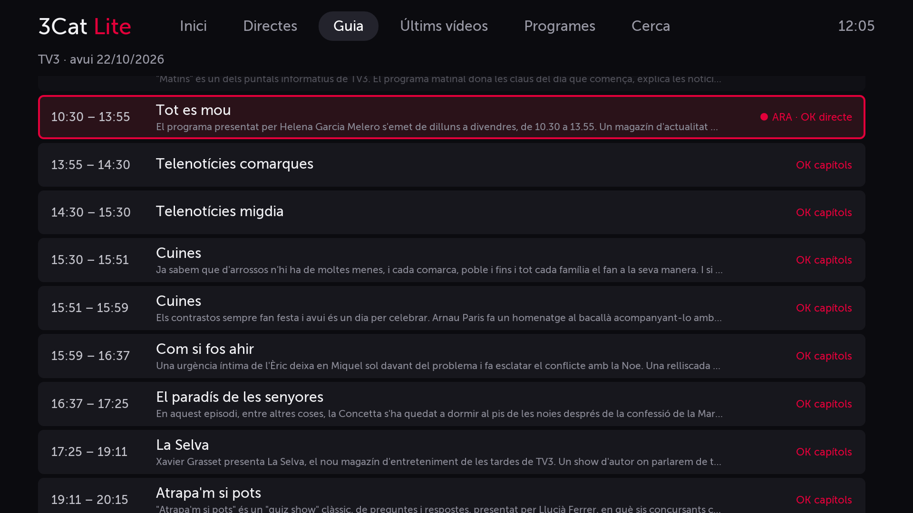
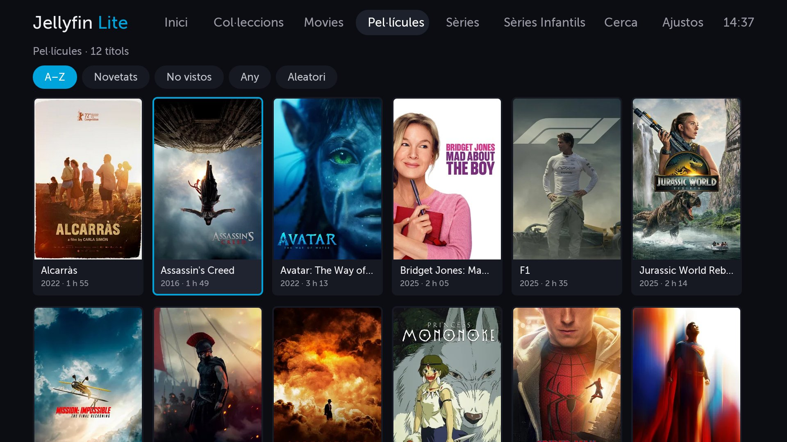
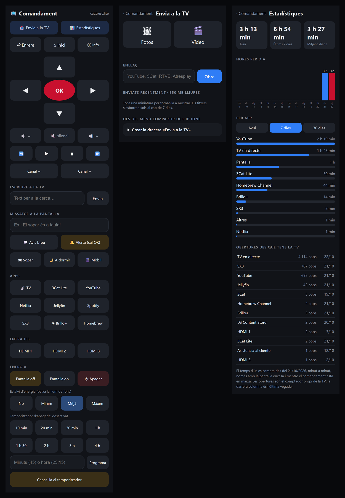

# tv-lg-uj620v

[English](README.md) · **Català** · [Castellano](README.es.md)

Apps i eines casolanes per a una **LG 49UJ620V** (2017, webOS 3.9) rootejada amb
[Homebrew Channel](https://github.com/webosbrew/webos-homebrew-channel).

> ⚠️ Projecte personal, sense cap relació amb LG ni amb la CCMA/3Cat. Fes-lo servir sota la teva
> responsabilitat: modificar una TV rootejada pot deixar-la en mal estat.
> **No creïs mai `start-devmode.sh`** en firmwares recents: el sistema en verifica la signatura i,
> si falla, desactiva el mode desenvolupador i esborra `/media/developer` (totes les apps de Homebrew).

> 🔒 **Només per a una xarxa local de confiança.** Amb Homebrew Channel la TV obre un telnet root
> **sense contrasenya** al port 23, i el comandament web (port 8080) no demana cap clau: qualsevol
> aparell de la xarxa pot controlar la TV. No obris mai els ports 23, 8080 ni 3000 a Internet (cap
> redirecció de ports al router ni DMZ) i no connectis la TV a xarxes Wi-Fi compartides o públiques.
> El comandament només accepta les accions per `POST` i des de les seves pròpies pàgines, perquè una
> web qualsevol oberta en un mòbil de casa no pugui prémer tecles ni apagar la TV.

## Contingut

| Carpeta | Què és |
|---|---|
| [`brillo/`](brillo) | **Brillo+** — control de llum de fons, brillantor, contrast, color, estalvi d'energia… amb perfils (Dia, Tarda, Nit, Cinema, 3 personals) i programació horària. |
| [`cat3/`](cat3) | **3Cat Lite** — client no oficial de 3Cat per a TVs on l'app nova no és compatible: directes, guia de programació, últims vídeos, programes A–Z, cerca, subtítols, preferits, «Continuar veient» i capítol següent automàtic (compte enrere de 10 s en acabar). |
| [`sx3/`](sx3) | **SX3 Lite** — només el canal infantil de 3Cat, més lleugera que l'app oficial: SX3 en directe amb la programació del dia, sèries per als petits i per als grans (només les que tenen capítols), últims capítols, cerca, «Les meves sèries», «Continuar veient» i capítol següent automàtic. Tot el text en majúscules, més fàcil per als nens que aprenen a llegir. |
| [`remote/`](remote) | **Comandament web** — servidor Node que corre a la TV (port 8080) amb una pàgina per al mòbil organitzada com el comandament d'LG (fletxes, volum, canals, tecles de colors i números, ajustos, llista d'entrades, teletext…; les tecles actuen en aixecar el dit, així que desplaçar la pàgina o el gest d'inici de l'iPhone no en premen cap), apps, entrades, missatges a la pantalla, pantalla off, estalvi d'energia, temporitzador d'apagada i **encendre la TV** (Wake-on-LAN a través de tvlinks). **Teclat**: quan la TV obre un camp de text (navegador, Wi-Fi, Jellyfin Lite…) el mòbil ho avisa i el que hi escrius surt a la TV en directe. Inclou **Envia a la TV** (`/envia`: diverses fotos i vídeos alhora i enllaços de YouTube, 3Cat, RTVE, Atresplayer… també des del menú **Compartir** d'Android i de l'iPhone), **Enviats** (`/enviats`: revisar, tornar a obrir i esborrar el que s'ha enviat, d'un en un, una selecció o tot), **Estadístiques** (`/estadistiques`: temps d'ús per dia i per app) i **Estat de la TV** (`/estat`: temperatura, memòria, disc, xarxa, serveis en marxa, apps instal·lades i registres d'arrencada). |
| [`jellyfin/`](jellyfin) | **Jellyfin Lite** — client lleuger de [Jellyfin](https://jellyfin.org): inici amb «Continuar veient», «Següents capítols» i novetats, una pestanya per biblioteca (A–Z, novetats, no vistos…), sèries per temporades, fitxa amb sinopsi, cerca, subtítols, canvi d'àudio, botó per saltar la intro i els crèdits i capítol següent automàtic. Entra amb Quick Connect (un codi a la pantalla) o usuari i contrasenya, i desa la posició al servidor. Reprodueix directament MP4/MOV (H.264, HEVC) i WebM; la resta (MKV…) la converteix el servidor a HLS. |
| [`pantalla/`](pantalla) | **Pantalla** — app de la TV que mostra el que s'envia des del mòbil: fotos (passi automàtic) i vídeos (inclòs HEVC `.mov` de l'iPhone). |
| [`arrencada/`](arrencada) | **Arrencada** — app invisible que la TV obre sola en engegar-se i que activa els serveis de Homebrew Channel (telnet, ssh, comandament…) sense haver d'obrir-lo. |
| [`tvlinks/`](tvlinks) | **tvlinks** — servei per a un ordinador de casa sempre encès (Linux) que, amb yt-dlp, converteix enllaços de pàgines de vídeo (RTVE, clips d'Atresplayer, autonòmiques, Vimeo…) en l'adreça directa que la TV pot reproduir (el contingut amb DRM no funciona). També encén la TV des del mòbil. |
| [`tvtool/`](tvtool) | Eines per a l'ordinador (Python): instal·lador d'un sol pas (`install.py`), consola root per telnet, pujar fitxers, depurar apps per CDP, script de neteja (*debloat*). |
| [`build/make_ipk.py`](build/make_ipk.py) | Empaqueta una carpeta d'app en un `.ipk` instal·lable. |









## Idiomes

Les apps i el comandament web estan en **català, castellà i anglès**. Comencen en l'idioma de la TV
(o del mòbil), o en anglès si no és cap d'aquests, i recorden el que triïs:

| App | On es canvia |
|---|---|
| Brillo+ | Fila **Idioma**, al final de la columna dreta (◀ ▶) |
| 3Cat Lite, SX3 Lite | Última pestanya de la barra de dalt (OK) |
| Jellyfin Lite | Pestanya **Ajustos** → **Idioma** |
| Comandament web | Selector al peu de cada pàgina; els avisos que surten a la TV segueixen l'idioma del mòbil |
| Pantalla | Fa servir l'idioma del mòbil que envia les fotos |

webOS no té el català com a idioma del sistema: a una TV en castellà, tria «Català» un cop a cada app.

## Com rootejar la TV

Tot això necessita root i [Homebrew Channel](https://github.com/webosbrew/webos-homebrew-channel).
Abans de res, comprova el teu model i firmware a [CanI.RootMy.TV](https://cani.rootmy.tv). Mètodes coneguts
segons [webosbrew.org](https://www.webosbrew.org/rooting/) (consultat l'octubre de 2026):

| Mètode | webOS | Estat |
|---|---|---|
| [DejaVuln](https://github.com/throwaway96/dejavuln-autoroot) | 3.5 i posteriors | **El que toca per a aquesta TV.** webOS 3.5 i 4.0 no tenen pegat i és molt probable que no en rebin mai; el firmware recent de la majoria de webOS 5+ i tot webOS 9 sí que estan pegats. |
| [faultmanager](https://github.com/throwaway96/faultmanager-autoroot) | 4.0 i posteriors (inclòs webOS 9) | Sense pegat conegut. No serveix per a webOS 3.x. |
| [WTA](https://www.webosbrew.org/rooting/wta) | — | Pegat en actualitzacions recents. |
| [crashd](https://gist.github.com/throwaway96/e811b0f7cc2a705a5a476a8dfa45e09f) | — | Pegat l'abril de 2024. |
| [RootMy.TV](https://rootmy.tv) | 3 a 6 | Pegat el 2022; segurament ja no funciona. |
| [GetMeNow](https://www.webosbrew.org/rooting/getmenow) | Alguns models d'1 a 3 | No funciona des que es va actualitzar l'app Developer Mode a principis de 2024. |
| [NVM](https://gist.github.com/throwaway96/827ff726981cc2cbc46a22a2ad7337a1) | Anteriors a 4.0 | Modificació de maquinari: cal obrir la TV i hi ha alta tensió. Només com a últim recurs. |

Amb DejaVuln, resumit de [les seves instruccions](https://github.com/throwaway96/dejavuln-autoroot#instructions):

1. Descarrega l'última versió (no el «Source code») i descomprimeix-la a l'arrel d'un USB amb una
   sola partició FAT32 o NTFS, sense cap carpeta pel mig.
2. Connecta'l a la TV (que sigui l'únic USB), obre'l amb l'app de **Música** o el reproductor
   multimèdia, entra a la carpeta `lol$(sh$IFS$(find$IFS/tmp` i intenta reproduir el fitxer `.mp3`
   que hi ha. És normal que surti un error dient que no es pot reproduir.
3. Quan els avisos diguin que el root s'ha completat, treu l'USB. Si no veus Homebrew Channel,
   reinicia la TV amb l'encesa ràpida desactivada.

Amb la TV rootejada, **no instal·lis l'app Developer Mode de LG** (si la tens, esborra-la abans de
reiniciar) i **no actualitzis el firmware**: el root podria desaparèixer i potser no es podria tornar a fer.

## Requisits

- TV LG amb webOS 3.x rootejada i Homebrew Channel (telnet root al port 23).
- A l'ordinador: Python 3 amb `websocket-client` i `Pillow`.
- Les eines fan servir la IP de la variable d'entorn `TV_IP` (si no hi és, `192.168.1.37`):

| Consola | Ordre |
|---|---|
| PowerShell | `$env:TV_IP = "192.168.1.37"` |
| CMD | `set TV_IP=192.168.1.37` |
| Bash (Linux, macOS, Git Bash) | `export TV_IP=192.168.1.37` |

## Instal·lar

Una sola ordre empaqueta, puja i instal·la el que li diguis, i és igual a qualsevol consola:

```bash
python tvtool/install.py brillo cat3
```

| Nom | Què instal·la |
|---|---|
| `brillo` | Brillo+ i el seu servei de programació (`init.d/brillo`) |
| `cat3`, `sx3`, `jellyfin`, `pantalla` | L'app corresponent |
| `arrencada` | Arrencada; la primera vegada desa una còpia de `/var/lib/eim` i la registra com a entrada |
| `remote` | El comandament web a `/media/developer/remote/` i el seu `init.d/remote` (el `config.json` de la TV no es toca); l'engega |
| `debloat` | L'script de neteja a `init.d/debloat`; s'aplica en reiniciar |

Per tornar a instal·lar una app amb canvis, puja abans el `version` del seu `appinfo.json`.

Les apps noves no surten soles a la barra d'inici si ja l'has editada: cal afegir `<appid>_default`
a la llista `com.webos.launcher.appordering:1` de db8 (com a `com.webos.surfacemanager`) i reiniciar.

## Scripts d'arrencada

Els scripts de `/var/lib/webosbrew/init.d/` s'executen quan corre l'script d'inici de Homebrew Channel.
En aquesta TV l'script no s'executa sol en engegar-se, i ho fa l'app **Arrencada** (o obrir a mà
Homebrew Channel). Amb «Encesa ràpida» activada, tot sobreviu a les apagades amb el comandament.

**Arrencada** (`cat.arrencada`) fa servir el mateix truc que
[webosbrew-autostart](https://github.com/webosbrew/webosbrew-autostart), sense tocar res del sistema:

- Està registrada com a «app d'entrada» (`com.webos.service.eim/addDevice`) i és l'última entrada
  desada a `/var/lib/eim`, així que la TV l'obre en engegar-se.
- En obrir-se llança `boot.sh` com a root: munta una còpia de `/var/lib/eim` a sobre (l'original no
  canvia mai més), s'amaga de la llista d'entrades, torna a l'última entrada real (o la TV) i crida
  `org.webosbrew.hbchannel.service/autostart`, que és el que fa l'app de Homebrew Channel.
- Si `restart sam` (de `debloat`) tanca l'app que s'havia obert, la torna a obrir. El registre queda a `/tmp/arrencada.log`.

S'instal·la amb `python tvtool/install.py arrencada` (per treure-la, vegeu [Desinstal·lar i recuperar](#desinstal·lar-i-recuperar)).

| Fitxer | Instal·lat a la TV com a |
|---|---|
| [`tvtool/debloat`](tvtool/debloat) | `/var/lib/webosbrew/init.d/debloat` — bloqueja dominis d'anuncis/telemetria, desactiva LivePlus i apps promocionals, amaga apps del menú |
| [`tvtool/brillo-init`](tvtool/brillo-init) | `/var/lib/webosbrew/init.d/brillo` — arrenca el servei de programació de Brillo+ |
| [`remote/remote-init`](remote/remote-init) | `/var/lib/webosbrew/init.d/remote` — arrenca el comandament web |

Per desfer qualsevol canvi: esborra el fitxer corresponent de `init.d` i reinicia la TV.

## Desinstal·lar i recuperar

Res d'aquest projecte toca el firmware: les apps són apps de desenvolupador normals i els scripts
d'arrencada només fan canvis que desapareixen en reiniciar. Tot es desfà amb `--remove`:

```bash
python tvtool/install.py --remove brillo cat3 sx3 jellyfin pantalla remote debloat arrencada
```

| Què | Què fa `--remove` | Què queda |
|---|---|---|
| Apps | Les desinstal·la; `brillo` també treu `init.d/brillo` | Res (els perfils de Brillo+ de `/media/developer/brillo/` es poden esborrar a mà) |
| `remote` | Atura el servidor i esborra `/media/developer/remote/` i `init.d/remote` | Els fitxers compartits de `/media/developer/share/` |
| `debloat` | Esborra `init.d/debloat`; **cal reiniciar** perquè tornin les apps i els dominis bloquejats | LivePlus i la galeta d'anuncis queden apagats; es tornen a activar a la configuració de la TV |
| `arrencada` | Desmunta `/var/lib/eim`, hi torna la còpia `/var/lib/webosbrew/eim.backup` i desinstal·la l'app; **cal reiniciar** | Res |

Si alguna cosa va malament:

- **La TV arrenca però no hi ha telnet (port 23).** L'script de Homebrew Channel no ha corregut:
  obre l'app **Homebrew Channel** i torna-ho a provar. Si tens Arrencada, mira `/tmp/arrencada.log` un cop dins.
- **Una app no s'obre o es queda en negre.** Torna-la a instal·lar o desinstal·la-la; no afecta res més.
- **La TV fa coses rares després d'arrencar.** Entra per telnet, treu els scripts de
  `/var/lib/webosbrew/init.d/` d'un en un i reinicia cada vegada per trobar el culpable, amb
  `luna-send -n 1 luna://com.webos.service.tvpower/power/reboot '{"reason":"reset"}'` (l'ordre `reboot` no fa res en aquesta TV).
- **Homebrew Channel ha desaparegut** (actualització de firmware, app Developer Mode de LG…).
  Les apps d'aquest projecte deixen de funcionar però la TV continua bé; torna-la a rootejar
  (vegeu [Com rootejar la TV](#com-rootejar-la-tv)).
- **Per treure també el root i Homebrew Channel**, desinstal·la-ho tot com a dalt i segueix les
  instruccions de [webosbrew.org](https://www.webosbrew.org/).

## Compartir des del mòbil

- **Android**: la pàgina del comandament és una PWA amb `share_target`, i un cop instal·lada surt com a
  «Comandament» al menú Compartir (fotos, vídeos i enllaços). Com que la TV no té HTTPS, abans cal
  afegir-ne l'adreça a `chrome://flags/#unsafely-treat-insecure-origin-as-secure` a Chrome. Els passos
  són a `/envia`.
- **iPhone**: una drecera «Envia a la TV» que envia cada element compartit a `POST /api/compartir`.
  El servidor hi accepta una foto, un vídeo o qualsevol cosa que contingui un enllaç, i les fotos que
  arriben seguides surten juntes al mateix passi. Els passos també són a `/envia`.
- Tot el que s'ha enviat (fitxers i els 50 últims enllaços) surt a `/enviats`, on es pot tornar a obrir
  a la TV o esborrar. Els fitxers també s'esborren sols al cap de 7 dies.

## Enllaços de vídeo amb yt-dlp

La TV no pot executar yt-dlp (el seu Python és massa antic), així que ho fa un altre ordinador de la
xarxa local que estigui sempre encès (un miniPC, un NAS amb Linux…) amb Python 3. Quan l'enllaç enviat
no és de YouTube, 3Cat ni un fitxer directe, el comandament demana `<servei>/resolve?u=<enllaç>` i obre
el resultat (MP4 o HLS, fins a 1080p) a Pantalla. El servei només respon a la xarxa local.

Instal·lació a l'ordinador (sense root; s'arrenca amb el `crontab` de l'usuari i yt-dlp s'actualitza cada dia):

```bash
mkdir -p ~/tvlinks && cp tvlinks/tvlinks.py tvlinks/start.sh ~/tvlinks/
curl -sSL -o ~/tvlinks/yt-dlp https://github.com/yt-dlp/yt-dlp/releases/latest/download/yt-dlp
chmod +x ~/tvlinks/yt-dlp ~/tvlinks/start.sh
(crontab -l; echo '@reboot $HOME/tvlinks/start.sh'; echo '*/5 * * * * $HOME/tvlinks/start.sh'
 echo '30 5 * * * python3 $HOME/tvlinks/yt-dlp -U >> $HOME/tvlinks/update.log 2>&1') | crontab -
~/tvlinks/start.sh
```

A la TV, copia [`remote/config.example.json`](remote/config.example.json) com a
`/media/developer/remote/config.json` amb l'adreça d'aquest ordinador (port 8097).

### Encendre la TV des del mòbil

Amb la TV apagada no hi ha cap servidor que respongui, així que l'encén tvlinks amb un paquet
Wake-on-LAN. Cal tenir activat al menú de la TV *Xarxa → Encén amb el mòbil* (`wolwowlOnOff`). El
comandament li diu la MAC de la TV en arrencar (`/wake/register`; tvlinks la desa a `wake.json`, fora del
repositori). La pàgina `<servei>/tv` és l'app per posar a la pantalla d'inici del mòbil («TV», amb icona
pròpia): mentre la TV respon hi mostra el comandament a dins, i quan és apagada, el botó d'encendre; ho
comprova cada 5 s, així que encendre o apagar la TV des d'on sigui la fa canviar. El comandament obert
sol hi va quan la TV deixa de respondre, i a Android l'app del comandament instal·lada hi va sola si la
TV no respon. Per a una drecera de l'iPhone n'hi ha prou amb `GET <servei>/wake`.

### Saltar la intro a Jellyfin Lite

Jellyfin Lite fa servir els segments del servidor (`/MediaSegments`, Jellyfin 10.10 o posterior), que
omple un connector com [Intro Skipper](https://github.com/intro-skipper/intro-skipper). Si no n'hi ha,
mira si els capítols del fitxer es diuen «Intro», «Opening», «Credits»… Quan comencen els crèdits d'un
capítol (o quan s'acaba), proposa el següent amb un compte enrere de 10 s.

## Notes tècniques (webOS 3.9)

- El navegador de les apps és Chromium 38: **només ES5** (res de `let`, `const`, fletxes…).
- `PalmSystem.platformBack()` no fa res: per sortir d'una app, `window.close()`.
- Tecles des de root: `luna://com.webos.service.networkinput/sendSpecialKey {"key":"UP"}`. Els noms
  que coneix són a `strings /usr/sbin/network-input-service` (`QMENU`, `LIST`, `TELETEXT`, `TEXTOPTION`,
  `ASPECT_RATIO`, `LIVE_ZOOM`, `RECORD`…); no n'hi ha per a subtítols, AD ni cerca. La llista d'entrades
  és l'app `com.webos.app.inputmgr`.
- Les apps de Homebrew poden executar ordres com a root amb `luna://org.webosbrew.hbchannel.service/exec`.
- API pública de 3Cat: `api.3cat.cat/videos`, `api.3cat.cat/programestv`, `api.3cat.cat/v2/graellatvfutur` (programació) i
  `api-media.3cat.cat/pvideo/media.jsp` (MP4 per als vídeos, HLS per als directes, subtítols VTT).
- Textos: cada app té un `i18n.js` amb el mateix nucli petit (`T()`, `translatePage()`) i les seves
  taules de castellà i anglès; el codi conserva els textos en català com a claus.

## Llicència

[MIT](LICENSE). Les dades i els continguts de 3Cat són propietat de la CCMA; aquest projecte només en consumeix l'API pública.
